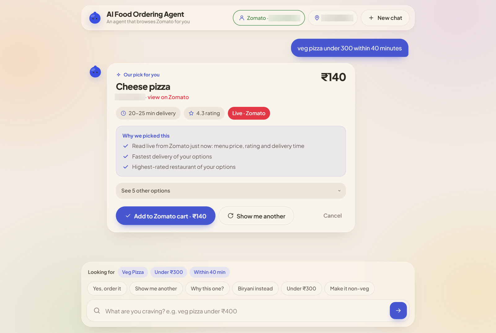
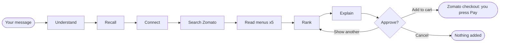
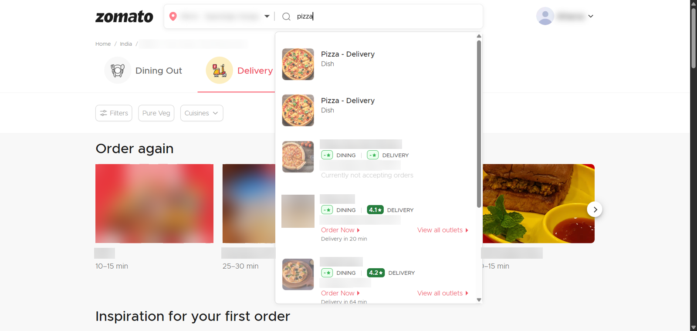
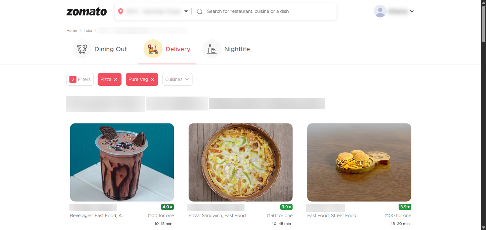
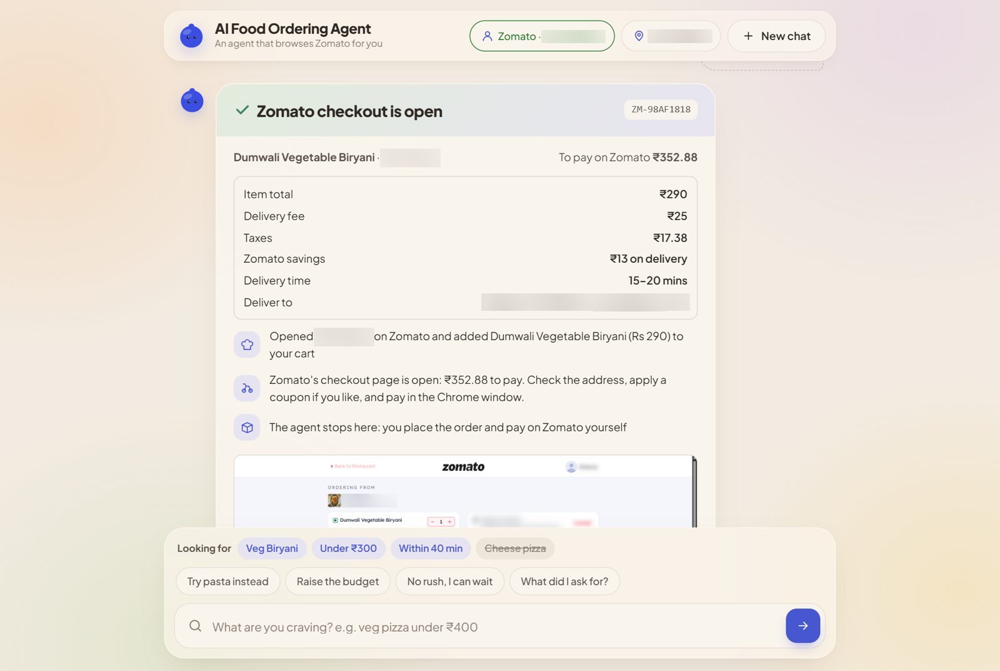
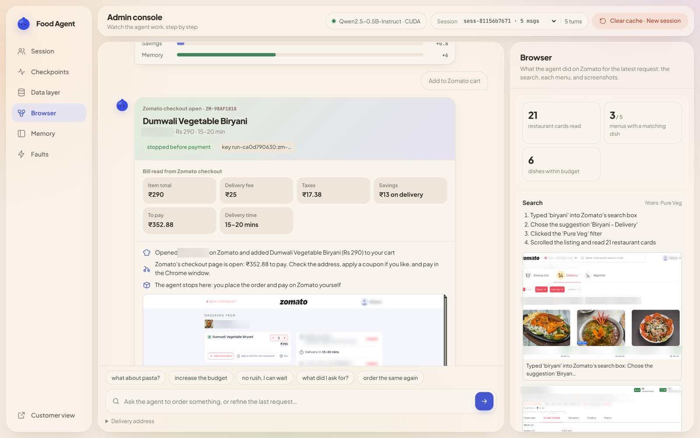

# AI Agent for Online Food Ordering

**An agent that searches the real Zomato website for you, compares menus, explains its pick and stops before you pay.**

Ask for *"veg pizza under ₹300 within 40 minutes"*. A small local language model reads the request, and the agent drives its own Chrome window: it types the dish into Zomato's search box, turns on the Pure Veg filter, reads the restaurants near your address, opens the best menus and ranks every dish that fits. On approval it adds the dish to your cart, opens checkout and reads the bill back. Pressing Pay is always yours.



## Highlights

- **Works on the real website.** Restaurants, dishes, prices, ratings and delivery times are read from Zomato at request time, for your own delivery address. There is no fixed dataset.
- **Understands any dish.** Rules and a local [Qwen2.5-0.5B-Instruct](https://huggingface.co/Qwen/Qwen2.5-0.5B-Instruct) model read the request together. The model's answer counts only if every word appears in the message, so it cannot invent a dish. On 20 unseen requests the combination reads the dish correctly 90 % of the time (rules alone 85 %, the model alone 65 %).
- **Remembers.** Follow-ups such as *"something cheaper"* or *"what about biryani?"* build on the conversation, and a FAISS memory of past orders fills in *"the same as last time"*.
- **Recovers.** Every step is checkpointed in SQLite. A page that fails to load is retried, an outage pauses the run, and Resume continues from the last saved step without searching Zomato again.
- **Fast follow-ups.** Searches and menus are reused for five minutes: a follow-up takes about 5 seconds instead of 40 to 50.
- **Safe by design.** The agent never types credentials and never pays. It waits for you to sign in, skips restaurants that are closed or do not deliver to you, warns when checkout is slower than you asked, and blurs your name, phone number and address in every screenshot it saves.
- **Runs on your machine.** The model and embeddings run locally (GPU optional); no API key is needed.

## How a request flows



| Step | What happens |
|---|---|
| **Understand** | Rules and the local model read the dish, diet, budget and delivery time; every value is checked against the text. With no dish, the agent asks instead of guessing. |
| **Recall** | Similar past orders and rejections are retrieved from long-term memory and fill in missing details. |
| **Connect** | Checks that the agent's Chrome window is signed in to Zomato with a delivery address, and waits for you if not. |
| **Search** | Types the dish into Zomato's search box, clicks the delivery suggestion and Pure Veg, and reads about twenty restaurant cards. Slow or unrated restaurants are dropped; the five best rated are kept. |
| **Read menus** | One checkpointed step per restaurant: every dish and price is read, and dishes matching every word of the request, the diet and the budget are kept. |
| **Rank** | Each dish is scored on rating (40), speed (35) and price (25), then adjusted by memory: +6 for a dish you ordered before, +2 for a familiar restaurant, −8 for a dish you declined. |
| **Explain** | A plain-language comparison in which every price and time is checked against the data. |

<table>
  <tr>
    <td width="50%"></td>
    <td width="50%"></td>
  </tr>
  <tr>
    <td align="center"><sub>The agent types the dish and picks Zomato's suggestion</sub></td>
    <td align="center"><sub>Pure Veg filter and restaurants near the delivery address</sub></td>
  </tr>
  <tr>
    <td width="50%"></td>
    <td width="50%"></td>
  </tr>
  <tr>
    <td align="center"><sub>On approval: the bill read from Zomato's checkout, stopped before Pay</sub></td>
    <td align="center"><sub>Admin console: every search, menu and screenshot</sub></td>
  </tr>
</table>

## Getting started

You need Windows, macOS or Linux with Python 3.12, Google Chrome (or Microsoft Edge), and about 1 GB of disk space for the two models, which download automatically on first start. A CUDA GPU is optional.

```bash
git clone https://github.com/Artifact19/agentic-order-desk.git
cd agentic-order-desk
pip install -r requirements.txt
python run.py            # on Windows you can also double-click run.bat
```

When the console shows `Uvicorn running on http://127.0.0.1:8000`, open:

| Page | Address | For |
|---|---|---|
| Customer app | http://127.0.0.1:8000 | Ordering through the agent |
| Admin console | http://127.0.0.1:8000/admin | Context, checkpoints, browser log, data layer, memory and fault injection |

On the first request the agent opens its own Chrome window (a separate profile in `data/chrome_profile`, so your everyday browser is untouched). Sign in to Zomato there and choose your delivery address once; the agent waits until you have, and the sign-in is remembered. The Zomato chip in the customer app turns green when it is ready.

To work offline, put the models in `models/Qwen2.5-0.5B-Instruct` and `models/all-MiniLM-L6-v2`; they are used instead of downloading.

### Things to try

1. `veg pizza under 300 within 40 minutes`, then `something cheaper`, `what about biryani?` and `why this one?`
2. Dishes without a Zomato dish page, such as `falooda under 200` or `paneer tikka under 300`
3. Hinglish: `bhai hakka noodles mangwa do 200 tak`
4. **Add to Zomato cart**: watch the checkout page open with the bill, then decide yourself
5. In the admin console, open **Faults**, break the **Rank** step, send an order, then press **Resume**
6. Start a new chat and ask for `the same as last time`

## Configuration

| Variable | Default | Meaning |
|---|---|---|
| `AGENT_PORT` | `8000` | Web server port |
| `AGENT_LLM_MODEL` | `Qwen/Qwen2.5-0.5B-Instruct` | Local language model |
| `AGENT_USE_LLM` | `1` | `0` uses the rule-based reader only |
| `AGENT_USE_EMBEDDINGS` | `1` | `0` uses a hashing embedder for memory |
| `AGENT_ZOMATO_CITY` | learned from your Zomato address | City in Zomato's URLs (set only to override) |
| `AGENT_RESTAURANTS` | `5` | Menus read per request |
| `AGENT_REQUIRE_ZOMATO_LOGIN` / `AGENT_REQUIRE_ZOMATO_ADDRESS` | `1` | Wait for sign-in and an address before browsing |
| `AGENT_ZOMATO_WAIT_SECONDS` | `600` | How long a run waits for sign-in before pausing |
| `AGENT_CHROME_PORT` | `9333` | DevTools port of the agent's Chrome window |
| `AGENT_DATA_DIR` | `./data` | Database, memory, screenshots and the Chrome profile |

## Testing

```bash
python -m pytest -q
```

44 tests run in a few seconds without a browser or GPU: a fake browser serves restaurant cards and menus in Zomato's own text format, and they go through the same parsers and matching rules as live pages. They cover request understanding, session context and memory, checkpoints, retries and resume, the sign-in wait, one-time hand-off, reuse of search results, price history, and skipping closed or non-delivering restaurants.

Request understanding is measured separately:

```bash
python evaluation/evaluate_understanding.py                                            # 60 labelled requests
python evaluation/evaluate_understanding.py --prompts evaluation/prompts_heldout.csv --name heldout
python evaluation/summarise_live_runs.py                                               # timings of live runs
```

| Method | Main set (60) | Held-out (20) |
|---|---|---|
| Rules only | 95 % | 85 % |
| Qwen2.5-0.5B only | 72 % | 65 % |
| Qwen2.5-1.5B only | 77 % | 75 % |
| Qwen2.5-1.5B + rules | 97 % | 85 % |
| **Qwen2.5-0.5B + rules (used)** | **100 %** | **90 %** |

The main set was used while tuning, so the held-out set is the fair measure.

## Project structure

```
app/
├── server.py           FastAPI routes and live event stream
├── service.py          the agent: checkpointed pipeline, commands and hand-off
├── zomato_browser.py   browser tools over the Chrome DevTools Protocol (search, menus, checkout, sign-in check)
├── understanding.py    rules + model request reading, session context
├── ranking.py          multi-attribute scoring and grounded explanations
├── memory.py           FAISS long-term memory
├── checkpoints.py      step runner with retry, pause and resume
├── repositories.py     sessions, runs, checkpoints, hand-offs and everything read from Zomato
├── database.py         SQLite schema and query metering
├── cache.py            TTL and LRU caches
├── faults.py           fault injection for demonstrations
├── llm.py              local model loading and JSON extraction
├── sessions.py         per-session context store
└── config.py           settings
static/                 customer app and admin console
evaluation/             labelled requests, evaluation scripts and results
tests/                  pytest suite with a fake browser
```

## Design choices

- **The model suggests, the code decides.** A 0.5-billion-parameter model is fast enough to run locally but too small to trust alone, so its answers are checked against the message and combined with rules. Ranking, eligibility and anything involving money are plain code.
- **Search like a person.** Typing into Zomato's search box gives restaurants that deliver to the signed-in address; Zomato's dish pages exist only for common dishes.
- **Browser tools, not a browsing model.** The clicks are deterministic tools the agent calls; this keeps a small local model useful and the behaviour repeatable.
- **A dedicated Chrome profile over DevTools.** The agent never touches your everyday browser, your Zomato sign-in persists between runs, and it works with any recent Chrome version.
- **Offers are shown, not subtracted.** Card offers such as "₹140 OFF" have minimum-order terms known only at checkout; the bill read at checkout is the real price.

## Limitations and responsible use

- Matching keeps dishes containing every word of the request, so *"paneer tikka"* can also match a paneer tikka rice bowl.
- Zomato's page layout can change; the selectors in `zomato_browser.py` would then need updating.
- This project is not affiliated with or endorsed by Zomato. Zomato's terms of use do not permit automated access, so it is meant as a supervised, low-volume local prototype on your own account, not as a service. Do not deploy it or run it at scale, and do not publish data collected with it.
